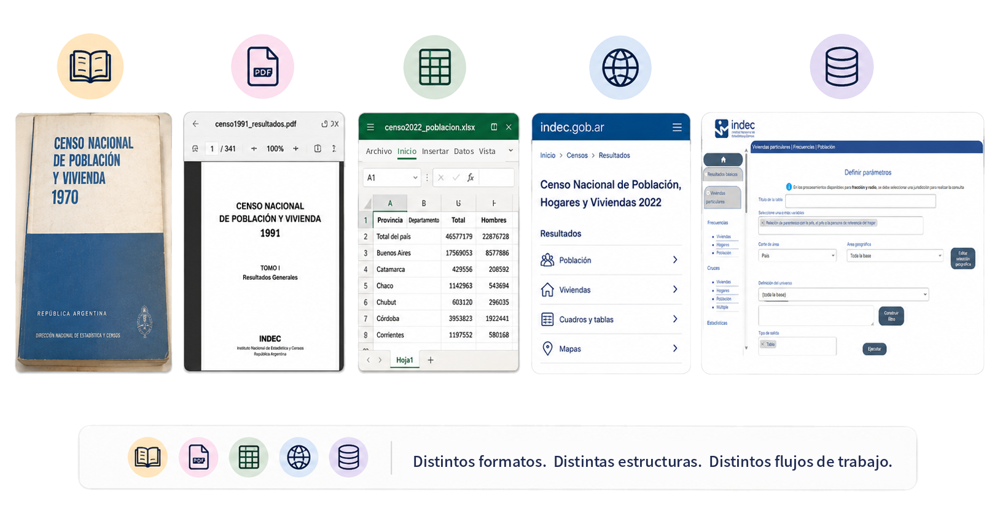
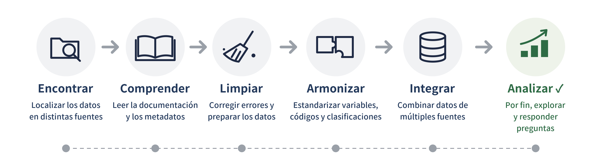
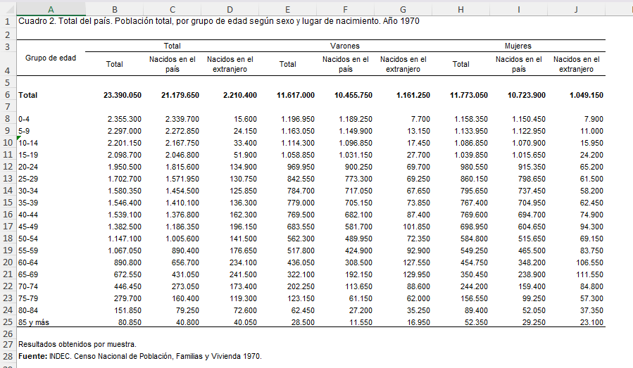
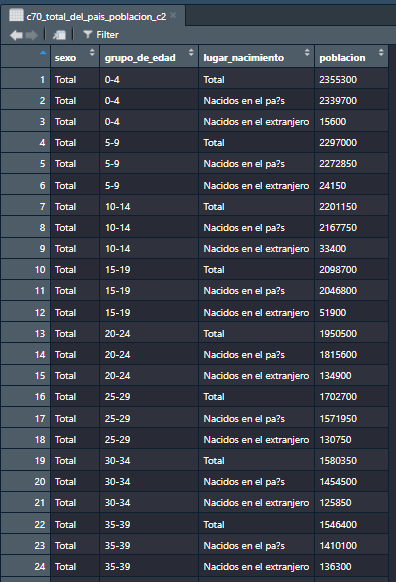

## Datos abiertos, ¿datos reutilizables?





## ¿Qué es **`ARcenso`**? {.smaller}

**ARcenso** es una iniciativa ciudadana que nació de nuestra experiencia profesional con datos censales en el INDEC.

Su objetivo es **facilitar el acceso y la reutilización de datos oficiales de los censos nacionales de población de Argentina (1970–2022)**, mediante un paquete de R que organiza y pone a disposición información censal estructurada y documentada.

Proyecto desarrollado con el apoyo del Programa de Campeones de rOpenSci (2023–2024).

{width=120px fig-align="center"} 


## El trabajo detrás de los datos




> Antes de responder un problema de investigación, necesitamos que los datos sean utilizables

## Objetivo

> Disponibilidad: de excel a **tablas ordenadas** en R

::::: columns
::: {.column width="70%"}
{width="110%"}
:::

::: {.column width="30%"}
{width="100%"}
:::
:::::


## Marco metodológico {.smaller}

Principios que orientan la organización y reutilización de los datos censales.

::::: columns

::: {.column width="50%"}

### Principios `FAIR`

- **Localizable (`Findable`):** datos centralizados y documentados.
- **Accesible (`Accessible`):** acceso abierto a los datos censales.
- **Interoperable (`Interoperable`):** tablas tidy y estructuras estandarizadas.
- **Reutilizable (`Reusable`):** metadatos y datos reproducibles.
:::

::: {.column width="50%"}

### Recomendaciones `ONU`

- **Temáticas:** núcleo, derivadas y adicionales.
- **Unidades conceptuales:** población, hogares y viviendas.
- **Cobertura geográfica:** nacional y subnacional(24 jurisdicciones).

:::

:::::


## ¿Cómo construimos ARcenso? {.smaller}


::: columns
::: {.column width="15%"}


<br>


<br>


:::

::: {.column width="85%"}

- **Descarga:** Automatización del proceso de recopilación de tablas censales desde fuentes oficiales mediante *web scraping*.

- **Selección:** Listado, clasificación y extracción de archivos y metadatos relevantes (año censal, nivel geográfico, temáticas).

- **Transformación:** Conversión de tablas de Excel en conjuntos de datos ordenados (*tidy*) y estandarizados utilizando R base.

- **Desarrollo de funciones:** Creación de funciones en R para acceder, manipular y visualizar los datos de forma eficiente.

- **Creación del paquete:** Integración de los conjuntos de datos y funciones en el paquete `ARcenso` para facilitar su uso.

- **Control de versiones:** Uso de Git y GitHub para el seguimiento de cambios y la gestión de versiones y colaboraciones.

:::

::: 

# `ARcenso` en R

##

### Funciones principales

- `check_repository()`: Verificar tablas disponibles según año, ubicación geográfica o temática


- `get_census()`: Obtener tablas censales


- `arcenso_app()`: Explorar datos mediante un tablero interactivo

### Metadatos censales


- `census_metadata`: temas disponibles


- `geo_metadata`: códigos geográficos


## Documentación y ejemplos de uso


```{r echo=FALSE}
knitr::include_url("https://soyandrea.github.io/arcenso/articles/indicadores_demograficos.html",height = 600)
```


## Próximos pasos :footprints:

:::::: incremental
::::: columns
::: {.column width="30%"}

<br>
<br>


:::

::: {.column width="70%"}

- **Cobertura censal:** incorporar progresivamente los censos de 1991 a 2022.

- **Infraestructura:** fortalecer y automatizar los procesos de incorporación, validación y actualización de datos.

- **Distribución:** publicar el paquete en CRAN y r-universe.

:::
:::::
::::::

##  

<div style="
  display: flex;
  align-items: center;
  justify-content: center;
  gap: 24px;
  height: 100%;
">
  <h1 style="margin: 0; font-family: 'Montserrat', sans-serif;">Gracias</h1>
  
</div>